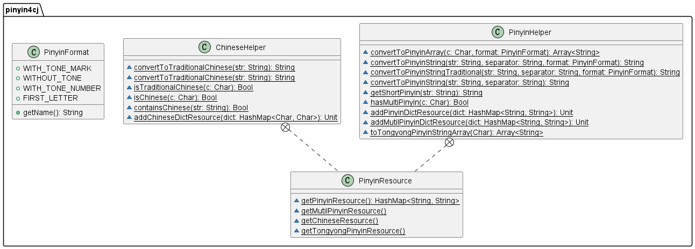

<div align="center">
<h1>pinyin4cj</h1>
</div>

<p align="center">


</p>

## 介绍

pinyin4cj 是一个支持将汉字转换成拼音的三方库，输出的拼音格式可以自定义设置。

### 特性

- 🚀 支持词、句转换成拼音

- 💪 支持常用简体/繁体中文字符转换成拼音

- 🛠️ 支持常见多音字符转换成拼音

- 🌍 支持Unicode格式的字符ü、支持声调符号、支持首字母格式

- 💪 支持常用简体、繁体中文字符互转

- 🚀 支持添加自定义字典

- 🛠️ 支持常用简体/繁体中文字符转换成通用拼音

## 软件架构



### 源码目录

```shell
.
├── doc
├── resource
├── ├── pinyin.dict.txt
├── src
│   ├── chinese_helper.cj
│   ├── chinese_dict.cj
│   ├── get_file_path.cj
│   ├── import.cj
│   ├── mutil_pinyin.dict.cj
│   ├── pinyin_format.cj
│   ├── pinyin_helper.cj
│   ├── pinyin_resource.cj
│   ├── tongyong_pinyin_dict.cj
└── test
│   ├── HLT
│   ├── LLT
│   └── UT
├── CHANGELOG.md
├── gitee_gate.cfg
├── LICENSE.txt
├── module.json
├── pinyin4cj_build.bat
├── pinyin4cj_build.sh
├── README.md
├── README.OpenSource
```

- `doc` 存放库的特性文档
- `resource` 存放拼音字典
- `src` 是库源码目录
- `test` 存放 HLT 测试用例、LLT 自测用例和 UT 单元测试用例

### 接口说明

主要类和函数接口说明详见 [API](./doc/feature_api.md)

## 使用说明

### 编译构建

1. linux x86_64 编译

```shell
./pinyin4cj_build.sh
```

2. Windows 编译
```shell
pinyin4cj_build.bat
```

### 功能示例

#### 繁体转简体

示例代码如下：

```cangjie
import pinyin4cj.*

main() {
    var pinyin: String = ChineseHelper.convertToSimplifiedChinese("臺，喪，麗")
    println(pinyin)
    return 0
}
```

执行结果如下：

```shell
台，丧，丽
```

#### 简体转繁体

示例代码如下：

```cangjie
import pinyin4cj.*

main() {
    var pinyin: String = ChineseHelper.convertToTraditionalChinese("我是中国人")
    println(pinyin)
    return 0
}
```

执行结果如下：

```shell
我是中國人
```

#### 词、句转换成拼音

示例代码如下：

```cangjie
import pinyin4cj.*

main() {
    var pinyin: String = PinyinHelper.convertToPinyinString("我是中国共产主义接班人。", " ")
    println(pinyin)
    return 0
}
```

执行结果如下：

```shell
wǒ shì zhōng guó gòng chǎn zhǔ yì jiē bān rén 。
```

#### 自定义输出格式

示例代码如下：

```cangjie
import pinyin4cj.*

main() {
    var pinyin: String = PinyinHelper.convertToPinyinString("我是中国共产主义接班人。", " ", PinyinFormat.WITH_TONE_NUMBER)
    println(pinyin)
    return 0
}
```

执行结果如下：

```shell
wo3 shi4 zhong1 guo2 gong4 chan3 zhu3 yi4 jie1 ban1 ren2 。
```

#### 添加自定义拼音字典

示例代码如下：

```cangjie
import pinyin4cj.*
import std.collection.*

main() {
    let map: HashMap<String, String> = HashMap<String, String>([("上", "shǎng")])
    PinyinHelper.addPinyinDictResource(map)
    var pinyin: String = PinyinHelper.convertToPinyinString("上午", " ", PinyinFormat.WITH_TONE_MARK)
    println(pinyin)
    return 0
}
```

执行结果如下：

```shell
shǎng wǔ
```

#### 添加自定义拼音组合字典

示例代码如下：

```cangjie
import pinyin4cj.*
import std.collection.*

main() {
    let map: HashMap<String, String> = HashMap<String, String>([("阿弥陀佛", "ā,mí,tuó,fó")])
    PinyinHelper.addMutilPinyinDictResource(map)
    var pinyin: String = PinyinHelper.convertToPinyinString("阿弥陀佛", " ", PinyinFormat.WITH_TONE_MARK)
    println(pinyin)
}
```

执行结果如下：

```shell
ā mí tuó fó
```

#### 添加自定义中文字典

示例代码如下：

```cangjie
import pinyin4cj.*
import std.collection.*

main() {
    let map: HashMap<Rune, Rune> = HashMap<Rune, Rune>([(r'癥', r'症')])
    ChineseHelper.addChineseDictResource(map)
    var pinyin: String = ChineseHelper.convertToSimplifiedChinese("癥")
    println(pinyin)
    return 0
}
```

执行结果如下：

```shell
症
```

#### 多音字转拼音集合

示例代码如下：

```cangjie
import pinyin4cj.*

main() {
    var pinyin: Array<String> = PinyinHelper.convertToPinyinArray(r'长', PinyinFormat.WITH_TONE_MARK)
    println(pinyin)
    return 0
}
```
执行结果如下：

```
["cháng", "zhǎng"]
```

#### 繁简体转拼音

示例代码如下：

```cangjie
import pinyin4cj.*

main() {
    var pinyin: Array<String> = PinyinHelper.convertToPinyinArray(r'嚴', PinyinFormat.WITH_TONE_MARK)
    println(pinyin)
    return 0
}
```
执行结果如下：

```
["yán"]
```

#### 繁简体转通用拼音

示例代码如下：

```cangjie
import pinyin4cj.*

main() {
    var simplePinyin: Array<String> = PinyinHelper.toTongyongPinyinStringArray(r'傳')
    var traditionalPinyin: Array<String> = PinyinHelper.toTongyongPinyinStringArray(r'传')
    println(simplePinyin)
    println(traditionalPinyin)
    return 0
}
```
执行结果如下：

```
["chuan2", "jhuan4"]
["chuan2", "jhuan4"]
```

## 约束与限制

在下述版本验证通过：

    Cangjie Version: 0.59.6

## 开源协议

本项目基于 [MIT License](./LICENSE)，请自由的享受和参与开源。

## 参与贡献

欢迎给我们提交PR，欢迎给我们提交Issue，欢迎参与任何形式的贡献。